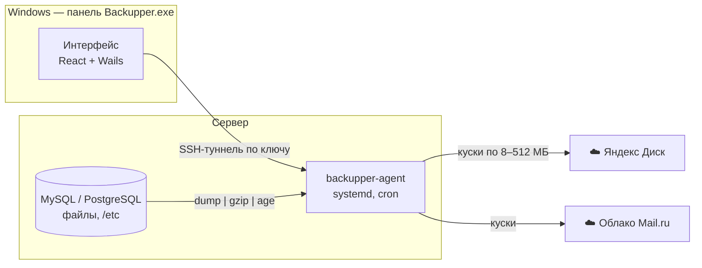

<div align="center">

# 🛡️ Backupper

**Бэкапы серверов в Яндекс Диск и Облако Mail.ru — по расписанию, без участия вашего компьютера**


</div>

Базы MySQL / MariaDB / PostgreSQL, файлы сайтов и конфиги серверов уходят в облако **потоком, кусками** — без временных архивов
на диске сервера. Настраивается всё из удобной панели для Windows, а работает — само, на сервере.

## ✨ Возможности

- **Не зависит от ПК.** На сервер ставится лёгкий агент (служба systemd), он сам выполняет задачи по расписанию.
- **Не нужно место на диске.** `дамп → gzip → шифрование → куски в памяти → облако`. Бэкап базы на 50 ГБ проходит на сервере с 2 ГБ свободного места.
- **Умный размер кусков.** Подбирается по свободной RAM, измеренной скорости до облака и лимитам облака; во время бэкапа куски уменьшаются при нехватке памяти, а непрошедший кусок делится пополам.
- **Облака:** Яндекс Диск (REST API или WebDAV), Облако Mail.ru (WebDAV), любой WebDAV (Nextcloud и др.). Несколько облаков в одной задаче.
- **Источники:** MySQL/MariaDB (`mysqldump`), PostgreSQL (`pg_dump` / `pg_dumpall`), файлы сайта с исключениями, конфиги сервера (≈20 типовых путей).
- **Расписание:** ежедневно, по дням недели, раз в месяц, каждые N часов или cron — с предпросмотром ближайших запусков.
- **Ротация:** хранить N последних успешных копий, неудачные и недокачанные удаляются.
- **Шифрование** в формате [age](https://age-encryption.org) (совместимо с утилитой `age -d`).
- **Уведомления в Telegram** отправляет сам агент — придут, даже если ПК выключен.
- **Восстановление из панели:** список копий прямо из облака, скачивание с расшифровкой.
- **Безопасно:** панель ходит к агенту через SSH-туннель по вашему ключу, агент слушает только `127.0.0.1` и требует токен; секреты панели зашифрованы DPAPI.
- **Бережно к сайтам:** агент работает с `nice 10` и пониженным приоритетом ввода-вывода.

## 🧭 Как это устроено



В облаке копии лежат так:

```
<папка>/<сервер>/<задача>/2026-10-23_03-00-00/
    shop__shop.sql.gz.age.part0001
    shop__shop.sql.gz.age.part0002
    site.tar.gz.age.part0001
    manifest.json
```

## 🚀 Начало работы

1. Скачайте или соберите `Backupper.exe` и запустите.
2. **Облака** → подключите Яндекс Диск (OAuth-токен, инструкция прямо в форме) или Облако Mail.ru (пароль для внешнего приложения).
3. **Добавить сервер** → адрес, пользователь (`root` или пользователь с `sudo` без пароля), приватный SSH-ключ → **Установить агент**.
4. **Новая задача** → источники, расписание, облака, сколько копий хранить, шифрование, размер кусков.
5. **Настройки** → пароль шифрования и Telegram.

## 🔧 Сборка

Нужны Go 1.25+, Node.js 20+ и Wails CLI:

```powershell
go install github.com/wailsapp/wails/v2/cmd/wails@latest
.\build.ps1
```

Скрипт собирает агентов для `linux/amd64` и `linux/arm64`, вкладывает их в панель и собирает `build\bin\Backupper.exe`.

Тесты:

```powershell
go test ./internal/...
```

## ♻️ Восстановление вручную

Панель не обязательна — части склеиваются обычными утилитами:

```bash
cat site.tar.gz.age.part* | age -d | tar -xz -C /restore   # зашифрованный архив
cat shop__shop.sql.gz.part* | gunzip | mysql shop           # дамп без шифрования
```

## 📁 Структура проекта

| Путь | Что внутри |
|---|---|
| `cmd/agent` | точка входа агента (`serve`, `install`, `uninstall`, `token`) |
| `internal/agent` | планировщик, источники, потоковая выгрузка, ротация, API |
| `internal/chunk` | подбор размера кусков |
| `internal/storage` | клиенты Яндекс Диска (REST) и WebDAV |
| `internal/desktop` | SSH, установка агента, хранилище настроек панели |
| `frontend` | интерфейс панели (React + TypeScript) |

## 📍 Где что лежит на сервере

| | |
|---|---|
| Агент | `/usr/local/bin/backupper-agent`, служба `backupper-agent` |
| Настройки | `/etc/backupper/config.json` (`0600`, root) |
| История запусков | `/var/lib/backupper/` |
| Логи службы | `journalctl -u backupper-agent` |
