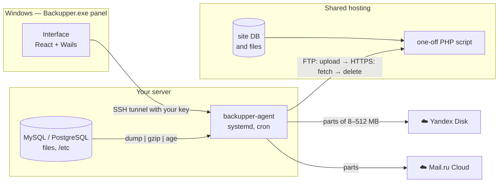

<div align="center">

# 🛡️ Backupper

**Server backups to Yandex Disk and Mail.ru Cloud — on schedule, without your computer**


</div>

MySQL / MariaDB / PostgreSQL databases, site files and server configs are **streamed to the cloud in parts** — no temporary
archives on the server disk. Everything is configured from a Windows desktop panel, and the work happens on the server by itself.
Sites on shared hosting without SSH are backed up too, through a one-off PHP script uploaded over FTP.

The interface is available in **English and Russian**.

## ✨ Features

- **Independent of your PC.** A lightweight agent (systemd service) runs on each server and executes jobs on schedule.
- **No disk space needed.** `dump → gzip → encryption → parts in memory → cloud`. A 50 GB database backs up on a server with 2 GB free.
- **Smart part size.** Picked from free RAM, measured upload speed and cloud limits; during a backup parts shrink when memory runs low, and a part the network rejects is split in half.
- **Clouds:** Yandex Disk (REST API or WebDAV), Mail.ru Cloud (WebDAV), any WebDAV (Nextcloud, etc.). Several clouds per job.
- **Sources:** MySQL/MariaDB (`mysqldump`), PostgreSQL (`pg_dump` / `pg_dumpall`), site files with excludes, server configs (~20 common paths).
- **Shared hosting (FTP / FTPS / SFTP):** database and files of PHP sites, credentials auto-detected for **1C-Bitrix** and **WordPress**.
- **Schedule:** daily, on weekdays, monthly, every N hours or cron — with a preview of the next runs.
- **Rotation:** keep the N latest successful backups; failed and incomplete ones are removed.
- **Encryption** in the [age](https://age-encryption.org) format (works with `age -d`).
- **Telegram notifications** are sent by the agent itself — they arrive even when your PC is off.
- **Restore from the panel:** list backups straight from the cloud, download with decryption.
- **Secure:** the panel talks to the agent through an SSH tunnel with your key; the agent listens on `127.0.0.1` only and requires a token; panel secrets are encrypted with DPAPI.
- **Gentle on sites:** the agent runs with `nice 10` and low I/O priority.

## 🧭 How it works



Backups are stored in the cloud like this:

```
<folder>/<server>/<job>/2026-10-23_03-00-00/
    shop__shop.sql.gz.age.part0001
    shop__shop.sql.gz.age.part0002
    site.tar.gz.age.part0001
    manifest.json
```

## 🌐 Sites on shared hosting

For hostings with FTP but no SSH, a job source **“Site on hosting (FTP)”** is available:

1. The agent connects over FTP / FTPS / SFTP and uploads `backupper_<random>.php` into the site root.
2. Over HTTPS it asks the script for the database dump and the files **in portions** of ~20 s each — this fits any `max_execution_time`, and nothing is written to the hosting disk.
3. Every request is signed with HMAC-SHA256 and a timestamp; every response is encrypted with AES-256-GCM using a secret that exists only for this run. Without a valid signature the script answers with a plain 404.
4. Right after the backup the script is deleted. Leftovers of a crashed run are removed on the next one.

Database credentials are read from `bitrix/.settings.php` / `dbconn.php` or `wp-config.php` (or entered manually), and CMS caches are skipped.

## 🚀 Getting started

1. Download or build `Backupper.exe` and run it.
2. **Clouds** → connect Yandex Disk (OAuth token, instructions are in the form) or Mail.ru Cloud (app password).
3. **Add server** → address, user (`root` or a user with passwordless `sudo`), private SSH key → **Install agent**.
4. **New job** → sources, schedule, clouds, how many backups to keep, encryption, part size.
5. **Settings** → encryption password, Telegram, interface language.

## 🔧 Building

Requires Go 1.25+, Node.js 20+ and the Wails CLI:

```powershell
go install github.com/wailsapp/wails/v2/cmd/wails@latest
.\build.ps1
```

The script builds agents for `linux/amd64` and `linux/arm64`, embeds them into the panel and produces `build\bin\Backupper.exe`.

Tests:

```powershell
go test ./internal/...
# end-to-end test of the shared-hosting backup with real PHP, MariaDB and SFTPGo (OSPanel modules)
$env:BACKUPPER_IT = "D:\OSPanel\modules"; go test ./internal/site -run IT -v
```

## ♻️ Restoring by hand

The panel is optional — parts are joined with standard tools:

```bash
cat site.tar.gz.age.part* | age -d | tar -xz -C /restore   # encrypted archive
cat shop__shop.sql.gz.part* | gunzip | mysql shop           # unencrypted dump
```

## 📁 Project layout

| Path | Contents |
|---|---|
| `cmd/agent` | agent entry point (`serve`, `install`, `uninstall`, `token`) |
| `internal/agent` | scheduler, sources, streaming upload, rotation, API |
| `internal/site` | shared-hosting backup: FTP/SFTP client, PHP script, signed protocol |
| `internal/chunk` | part size planner |
| `internal/storage` | Yandex Disk (REST) and WebDAV clients |
| `internal/desktop` | SSH, agent installation, panel settings storage |
| `frontend` | panel interface (React + TypeScript), translations in `src/i18n.en.ts` |

## 📍 Where things live on the server

| | |
|---|---|
| Agent | `/usr/local/bin/backupper-agent`, service `backupper-agent` |
| Settings | `/etc/backupper/config.json` (`0600`, root) |
| Run history, SFTP host keys | `/var/lib/backupper/` |
| Service logs | `journalctl -u backupper-agent` |

## 👤 Author

Igor Gladyshev — Telegram [@gladyshev](https://t.me/gladyshev), [gladyshev18@gmail.com](mailto:gladyshev18@gmail.com)
